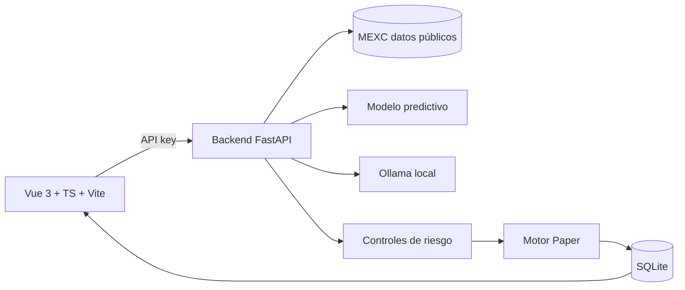

# Agente de trading BTC/USDT (Paper) — MEXC · Ollama · Vue

> ⚠️ **Solo simulación (Paper).** No envía órdenes reales, no es asesoría financiera. Proyecto académico de Deep Learning para Finanzas.

_Estado: **v1 en desarrollo** (ver `PLAN_V1.md`)._

## Qué hace
Observa velas diarias **cerradas** de BTC/USDT de **MEXC** (datos públicos), calcula las variables del modelo, obtiene un pronóstico, consulta un **LLM local (Ollama)** para proponer comprar/mantener/vender, aplica **controles de riesgo deterministas**, simula la ejecución en **Paper** y registra todo en SQLite. Una UI en **Vue 3 + TypeScript + Vite** muestra el estado y permite iniciar, pausar y detener.

## Arquitectura

## Tecnologías y versiones aplicadas
<!-- VERSIONES:START -->
_Ejecuta `python scripts/versions.py` para generar esta tabla._
<!-- VERSIONES:END -->

## Instalación y ejecución
_Pendiente: Claude Code completará estos pasos en la Fase 10._

## Seguridad
- Secretos solo en el servidor (`.env`, fuera del repo). Ver `.env.example`.
- Ruta de órdenes reales **inexistente**, con prueba automatizada.

## Pendientes
- `npm audit` reporta vulnerabilidades en `picomatch`, una dependencia transitiva **solo de desarrollo** (vite/vitest); no se incluye en el build. Pendiente actualizar cuando el proyecto original publique la corrección.
- Aviso de deprecación de Starlette sobre `httpx` en `TestClient` (solo en pruebas).
- Confirmar con el profesor el uso de Vue en lugar de React.

## Licencia
MIT — ver `LICENSE`.
