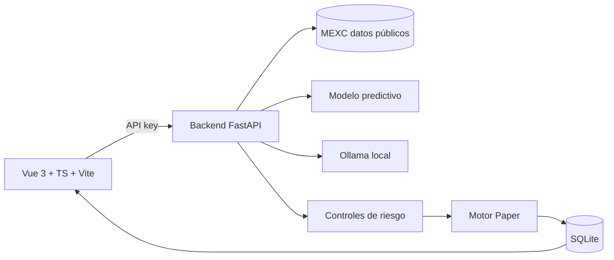

# Agente de trading BTC/USDT (Paper) — MEXC · Ollama · Vue

[](https://github.com/javieralejan2005/dl-trading-agent-btcusdt/actions/workflows/ci.yml)

> ⚠️ **Solo simulación (Paper).** No envía órdenes reales, no es asesoría financiera. Proyecto académico de Deep Learning para Finanzas.

_Estado: **v1 en desarrollo — Fase 1 de 10 completada** (esqueleto + CI). Ver [`PLAN_V1.md`](PLAN_V1.md)._

## Objetivo de v1
Un agente que observe velas diarias **cerradas** de BTC/USDT de **MEXC** (solo datos públicos), calcule las variables del modelo, obtenga un pronóstico, consulte un **LLM local (Ollama)** para proponer comprar/mantener/vender, aplique **controles de riesgo deterministas**, simule la ejecución en **Paper** y lo registre todo en SQLite, con una UI en **Vue 3 + TypeScript + Vite**.

**Nada de lo anterior está implementado todavía** salvo el esqueleto descrito abajo.

## Qué existe hoy (Fase 1)
| Componente | Estado |
|---|---|
| Backend FastAPI con `GET /api/salud` (responde `modo: PAPER`) | ✅ con prueba (pytest) |
| Frontend Vue 3 + TS + Vite + Pinia con etiqueta **PAPER** fija | ✅ con prueba (vitest) |
| Linters: ruff + mypy estricto (backend), oxlint + eslint + vue-tsc (frontend) | ✅ `make lint` en verde (local y CI) |
| GitHub Actions (backend y frontend) | ✅ en verde en GitHub (lint + pruebas + build) |
| Configuración de riesgo y agente (`config/*.yaml`) | Solo archivos de configuración; aún no se usan |

## Arquitectura planeada

Detalle en [`docs/ARQUITECTURA.md`](docs/ARQUITECTURA.md).

## Tecnologías y versiones aplicadas
<!-- VERSIONES:START -->
| Tecnología | Versión | Uso |
|---|---|---|
| Python | 3.12.14 | Lenguaje del backend |
| Node.js | 22.20.0 | Entorno del frontend |
| Ollama | 0.40.16 | LLM local |
| fastapi | 0.163.2 | API del backend |
| uvicorn | 0.54.0 | Servidor ASGI |
| pydantic | 2.14.3 | Validación de datos y JSON del LLM |
| sqlalchemy | no instalado | Persistencia (SQLite) |
| apscheduler | no instalado | Ciclo programado |
| httpx | 0.28.1 | Cliente HTTP (MEXC, Ollama) |
| tensorflow | no instalado | Modelo predictivo (Keras) |
| scikit-learn | no instalado | Escaladores / regresión lineal |
| numpy | no instalado | Cálculo numérico |
| pandas | no instalado | Datos |
| pytest | 9.2.0 | Pruebas backend |
| ruff | 0.17.5 | Linter Python |
| mypy | 2.4.1 | Tipado estático Python |
| vue | 3.5.45 | Interfaz (Vue 3) |
| typescript | 6.0.3 | Tipado del frontend |
| vite | 8.3.8 | Build y servidor de desarrollo |
| pinia | 4.1.0 | Estado de la UI |
| vitest | 4.1.12 | Pruebas frontend |
| eslint | 10.15.0 | Linter JS/TS |
| vue-tsc | 3.3.14 | Chequeo de tipos Vue |

_Generado con `scripts/versions.py`._
<!-- VERSIONES:END -->

Las tecnologías marcadas como _no instalado_ están previstas para fases posteriores y aún no se usan.

## Requisitos
- **Python 3.12** (mínimo 3.11)
- **Node.js 22 LTS** (≥ 22.18, o ≥ 24.12). **Node 23 no es compatible** (jsdom/undici); `make check-node` lo detecta. Ver `frontend/.nvmrc`.
- `make`

## Instalación y ejecución (lo que funciona hoy)
```bash
make setup         # crea .venv e instala backend + frontend
make test          # pytest + vitest
make lint          # ruff + mypy + oxlint + eslint + vue-tsc
make dev-backend   # API en http://127.0.0.1:8000  (GET /api/salud)
make dev-frontend  # UI en http://localhost:5173 (proxy /api -> backend)
```
Si `python3.12` no está en tu PATH: `make setup PYTHON=/ruta/a/python3.12`.

## Seguridad
- Secretos solo en el servidor (`.env`, fuera del repo). Ver `.env.example` (solo campos vacíos o de ejemplo).
- El código actual no contiene ningún cliente ni ruta de órdenes. La prueba automatizada que lo demuestra está planeada (ver DoD en `PLAN_V1.md`).

## Pendientes
- **Vue vs React**: el protocolo del curso pide React + TS; **por confirmar con el profesor**. Si exige React, solo cambia `frontend/`.
- **`npm audit`** reporta vulnerabilidades en `picomatch`, dependencia transitiva **solo de desarrollo** (vite/vitest); no se incluye en el build.
- **Aviso de deprecación de Starlette** sobre `httpx` en `TestClient` (solo en pruebas).
- `frontend/.npmrc` usa `legacy-peer-deps=true` por un bug de npm 10.9; los peers requeridos se declaran explícitamente.
- Fases 2–10 de `PLAN_V1.md` (datos MEXC, modelo, Ollama, riesgo/Paper/SQLite, ciclo, UI, 9 errores, evaluación). Los artefactos reales del modelo aún no están en `models/`.

## Licencia
MIT — ver `LICENSE`.
