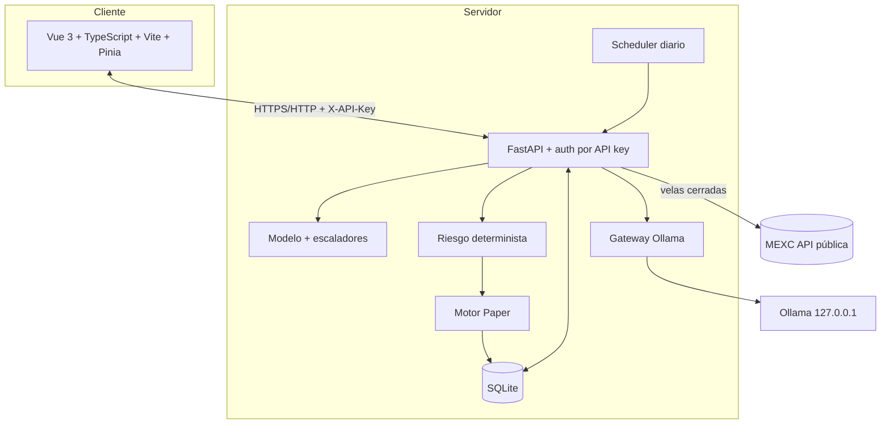

# Arquitectura v1

## Ciclo (siete pasos)
1. Velas cerradas y validación (activo, frecuencia, orden, antigüedad)
2. Variables con la definición del entrenamiento → pronóstico
3. Ollama propone comprar/mantener/vender con datos estructurados
4. JSON `{accion, simbolo, fecha_vela, justificacion}` validado (Pydantic)
5. Controles de riesgo deterministas
6. Ejecución Paper, registro y actualización (idempotente por `open_time`)
7. UI actualizada; espera siguiente vela o intervención

## Tablas SQLite (mínimo)
`velas`, `decisiones` (propuesta LLM, decisión final, motivo), `ordenes_paper`, `costos`, `patrimonio`, `errores`, `estado_agente` (para recuperar tras reinicio sin duplicar).
